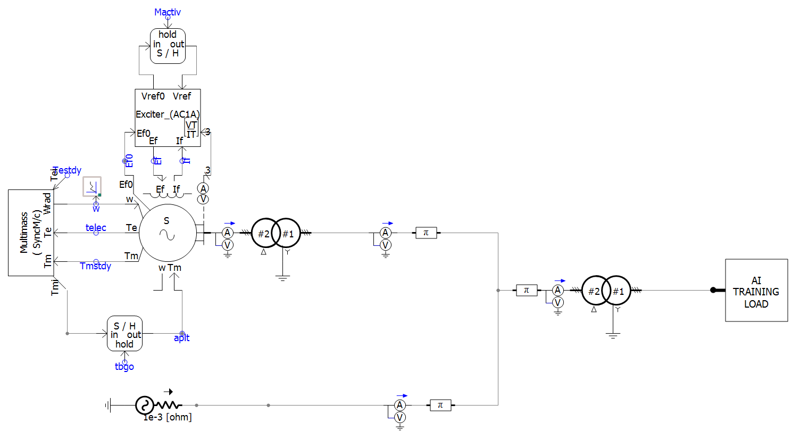

# EMT Models for Studying the Impact of Load-Induced High-Frequency Oscillations on Hydropower Units

EMT models in PSCAD for studying hydro-generator shaft fatigue risk arising from persistent high-frequency active-power oscillations induced by large AI data center loads.
If this repository is useful in your work, please cite **Chatterjee, Kaustav, Meghana Ramesh, Shuchismita Biswas, Brett A. Ross, Antos C. Varghese, Sameer Nekkalapu, and Slaven Kincic. "Assessing Risks of Hydro-Generator Shaft Fatigue from Data Center Load Oscillations." arXiv preprint arXiv:2607.14412 (2026).
**
## Folder Contents

| File | Type | Purpose |
|---|---|---|
| `DML_Components` | PSCAD component library | Shared library of custom models (data center load models, hydro-generator/turbine-governor models, measurement/control blocks, etc.) referenced by both case files below. Must be added as a library project before compiling/running the other two files. |
| `hydro_grid_AI_load_freq.pscx` | PSCAD case | Simulates dynamic response of a multi-mass hydro-generator connected to an AI data center load |
| `hydro_grid_AI_load_TF.pscx` | PSCAD case | Simulates the time-series data for evaluating the transfer function of a multi-mass hydro-generator model |
| `hydro_grid_AI_load_playback.pscx` | PSCAD case | Replays a time-varying AI-load profile and records the electrical torque and shaft-torque responses used for broadband transfer-function estimation. |
| `TF_estm_from_AI_playback_data.py` | Python script | Estimates the transfer function from electrical torque, T_e, to generator–turbine shaft torque, T_m, using direct FFT division and the H_1 cross-spectral estimator. The script also calculates magnitude-squared coherence. |
## Case File Details

### Time-Domain Simulation - `hydro_grid_AI_load_freq.pscx`

Run this file to simulate the dynamic response of a multi-mass hydro-generator connected to an AI data center load.

<ol type="a">
<li>The AI training load <a href="#ref1">[1]</a> is modeled to represent a bi-periodic square-wave workload profile. Users can configure the base load, amplitude of load fluctuation, and frequencies and duty cycle of the bi-periodic square wave.
<p align="center">
  
</p>
<p align="center"><em>Fig. 1: PSCAD model - Multi-mass Hydro with AI data center load.</em></p></li>
<li>The electrical parameters of the generator to be configured in the synchronous machine model. The defaults are configured for a salient pole machine with parameters from <a href="#ref2">[2]</a>.</li>
<li>The machine speed, generator and turbine inertias, shaft stiffness and damping can be configured in the multi-mass component of the machine model. Example parameter values for three generator units Unit A, GC-7, GC-19, are listed in Table 1 [3].</li>
</ol>


<div align="center">

**Table 1: PSCAD multi-mass torsional shaft model parameters**

| Design Parameter | Units | Unit A | GC-7 | GC-19 |
|---|---|---|---|---|
| Generator rating | MVA | 500  | 60  | 715  |
| Rated speed | rpm | 150  | 200  | 72  |
| Turbine inertia | kg·m² | 1.68 × 10⁶ | 90.6 × 10³ | 8428 × 10³ |
| Generator inertia | kg·m² | 33.75 × 10⁶ | 0.653 × 10⁶ | 107 × 10⁶ |
| Shaft spring constant | Nm/rad | 18.66 × 10⁹ | 0.208 × 10⁹ | 12.09 × 10⁹ |
| Turbine damping | Nm·s/rad | 5.01 × 10⁶ | 1.37 × 10⁵ | 12.6 × 10⁶ |

</div>

---

### Transfer-Function Estimation

The transfer function from generator electrical torque to generator–turbine shaft torque is defined as

$$
H(f) = \frac{\Delta T_m(f)}{\Delta T_e(f)}
$$

where the electrical torque $T_e$ is the input and the shaft torque $T_m$ is the output. The transfer function can be estimated with either of the two approaches below.

#### Method 1: Individual Sinusoidal Simulations — `hydro_grid_AI_load_TF.pscx`

This case estimates the transfer function by applying one sinusoidal excitation frequency at a time.

1. The model injects a unit-amplitude sinusoidal active-power oscillation at the generator terminal.
2. Set the desired oscillation frequency with the `f_osc` parameter.
3. Run the simulation and record the generator electrical torque $T_e$ and the generator–turbine shaft torque $T_m$.
4. Repeat the simulation for each frequency in the desired range. Save the responses before changing `f_osc`.
5. Detrend the recorded signals to remove their steady-state offsets, giving $\Delta T_e$ and $\Delta T_m$.
6. Determine the oscillation amplitudes of $\Delta T_e$ and $\Delta T_m$ at each applied frequency.
7. Calculate the transfer-function magnitude as

```math
   \lvert H(f) \rvert = \frac{\lvert \Delta T_m(f) \rvert}{\lvert \Delta T_e(f) \rvert}
```

This approach provides a controlled frequency sweep, but it needs a separate PSCAD simulation for every excitation frequency.

#### Method 2: Transfer-Function Estimation from AI-Load Playback — `hydro_grid_AI_load_playback.pscx`

This case estimates the transfer function from a time-varying AI-load playback record.

1. The model replays a specified AI-load active-power profile in the PSCAD simulation. 
2. The load variation excites the hydro-generator over the frequencies contained in the playback signal.
3. Run the simulation and export the time, generator electrical torque ($T_e$), and generator–turbine shaft torque ($T_m$) channels to an Excel workbook.
4. Place the exported workbook in the same directory as `TF_estm_from_AI_playback_data.py`, or give its full path in the script.
5. Before running the script, change

```python
   FILE_PATH = Path("playback_load.xlsx")
```

   to the name or full path of the exported workbook, for example:

```python
   FILE_PATH = Path("my_PSCAD_playback_results.xlsx")
```

   or

```python
   FILE_PATH = Path(r"C:\PSCAD_results\my_PSCAD_playback_results.xlsx")
```

6. If necessary, adjust `SHEET_NAME`, `START_TIME`, `END_TIME`, and the displayed frequency range in the user-configuration section.
7. Run the script to calculate the direct FFT estimate, the $H_1$ estimate, and the magnitude-squared coherence.

##### Estimation Method

The script first detrends $T_e$ and $T_m$ to remove their steady-state operating values. It then estimates $H(f)$ in two ways.

**Direct FFT estimator**

$$
\hat{H}_{\mathrm{FFT}}(f) = \frac{Y(f)}{U(f)} = \frac{\Delta T_m(f)}{\Delta T_e(f)}
$$

This estimate is mainly a diagnostic comparison. Frequency bins with insufficient energy in $\Delta T_e(f)$ are excluded, because dividing by a very small input spectrum can produce unrealistically large gains.

**$H_1$ cross-spectral estimator**

$$
\hat{H}_{H_1}(f) = \frac{S_{T_e T_m}(f)}{S_{T_e T_e}(f)}
$$

where $S_{T_e T_m}$ is the cross-power spectral density between electrical torque and shaft torque, and $S_{T_e T_e}$ is the auto-power spectral density of the electrical torque:

$$
S_{T_e T_m}(f) = \mathbb{E}\left[\Delta T_e^{*}(f)\,\Delta T_m(f)\right]
$$

$$
S_{T_e T_e}(f) = \mathbb{E}\left[\Delta T_e^{*}(f)\,\Delta T_e(f)\right] = \mathbb{E}\left[|\Delta T_e(f)|^2\right]
$$

The spectra are calculated with Welch averaging over overlapping, Hann-windowed segments. Compared with direct FFT division, the $H_1$ estimator is less sensitive to output noise and to fluctuations in any single data record.

The script also calculates magnitude-squared coherence:

$$
\gamma^2(f) = \frac{|S_{T_e T_m}(f)|^2}{S_{T_e T_e}(f)\,S_{T_m T_m}(f)}
$$

Coherence ranges from 0 to 1 and shows how consistently $T_m$ is linearly related to $T_e$ at each frequency. High coherence supports interpreting the estimated gain and phase. Low coherence can come from weak input excitation, transient or time-varying behavior, nonlinear response, or shaft-torque components unrelated to $T_e$.

Treat the $H_1$ estimate as the primary transfer-function result. Use the direct FFT estimate for comparison.

> **Note:** The model and files are tested with PSCAD version 5.0.1.

## References

<a id="ref1"></a>[1] B. A. Ross and J. D. Follum, "Data Center Model Library for Electromagnetic Transient Analysis (PSCAD)," *IEEE Dataport*, 2026.

<a id="ref2"></a>[2] J. Bladh, P. Sundqvist, and L. U, "Torsional Stability of Hydropower Units Under Influence of Subsynchronous Oscillations," *IEEE Trans. on Power Syst.*, vol. 28, no. 4, 2013.

[3] Eilts, L. E., and Eugene Campbell. Shaft torsional oscillations of hydrogenerators. No. PB-102155. Bureau of Reclamation, Denver, CO (USA), 1979.
